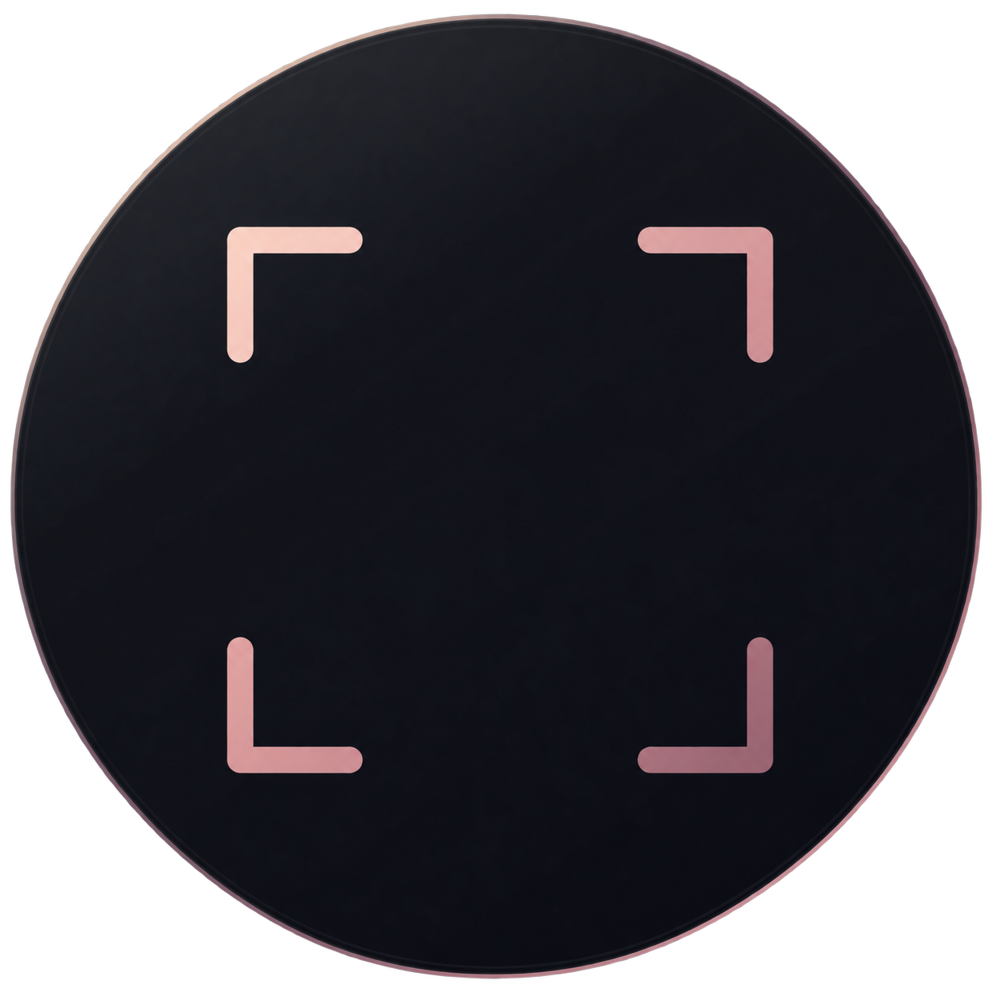

<h1 align="center">Screenshot</h1>

Screenshot captures windows and screen regions on Windows. It saves a PNG to `Pictures\Screenshot` and copies the same image to the clipboard.

[Download Screenshot 2.0.0 for Windows x64](https://github.com/sanderstripa/screenshot/releases/latest/download/Screenshot-2.0.0-Release-x64.exe)

## Use

Run the installer and follow the setup wizard to choose a capture shortcut. Press the shortcut, then click a window or drag to select a region. Open Screenshot to change the shortcut, theme, or language.

## Build

The native Rust application lives in `rust/` and the installer in `rust/setup/`. The [Windows build workflow](.github/workflows/rust-installer.yml) stages the application and installer assets, checks the executable and tests installation, updates, and removal.

The [classic source](https://github.com/sanderstripa/screenshot/tree/archive/classic) and [previous releases](https://github.com/sanderstripa/screenshot/releases) remain available.
